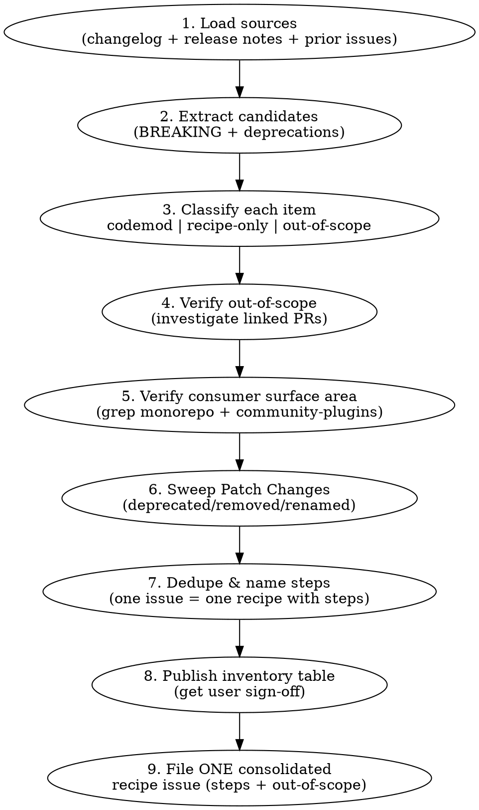

# Backstage Codemod Issue Research

Research a Backstage release and produce **one consolidated GitHub issue** in `backstage/codemods` before anyone scaffolds code. Since the v1.54 restructure, each release ships **one migration recipe package** (`codemods/v1.<minor>/`, `@backstage/v1-<minor>-0-migration-recipe`) bundling several deterministic local transform scripts behind one workflow — **not** one registry package per codemod. Output of this skill is an inventory table plus a single issue whose recipe-steps section specs each bundled script.

**Handoff:** After issues are filed and approved, switch to the **`codemod` skill** ([Codemod OSS quickstart](https://docs.codemod.com/oss-quickstart)) for scaffold → implement → test → publish. This skill stops at issue bodies.

## Handoff gate (verify before implementation)

Confirm the Codemod skill is installed for this repo before handing off. Use harness **auto-detection** (omit `--harness`); pass `--harness <name>` only when the user names their agent or auto-detection fails (`claude`, `goose`, `opencode`, `cursor`, `codex`):

```bash
npx codemod ai list --format json
```

Pass when `skills` includes an entry with `"name": "codemod"` and `"scope": "project"`. Use the `path` from that entry as the skill file — install location varies by harness (e.g. `.cursor/skills/` for Cursor, different paths for Claude/Goose/OpenCode/Codex).

If missing, install per [OSS quickstart](https://docs.codemod.com/oss-quickstart):

```bash
npx codemod ai --project
```

Then **restart or reload the agent session** so the skill and Codemod MCP are picked up (see install output `restart_hint`).

Hand off with: the approved inventory table and the filed consolidated issue link as the implementation spec. The implementer follows the installed **`codemod` skill** (path from `codemod ai list`) plus [`CONTRIBUTING.md`](../../../CONTRIBUTING.md).

## Setup

| Gate      | Check                                         | If fail                                                                               |
| --------- | --------------------------------------------- | ------------------------------------------------------------------------------------- |
| Repo      | Working in `backstage/codemods`               | Clone or note repo URL for `gh issue create`                                          |
| Release   | Know target version (e.g. `1.<minor>.0`)      | Ask user                                                                              |
| Changelog | Consolidated changelog file available locally | Fetch from `backstage/backstage` — see Sources                                        |
| Prior art | Closed issues for previous release exist      | `gh issue list --repo backstage/codemods --state closed --search "Backstage 1.<N-1>"` |

Read [`CONTRIBUTING.md`](../../../CONTRIBUTING.md) for package naming and directory layout. Since v1.54 the layout is **one package per release**: `codemods/v1.<minor>/` containing `package.json`, `codemod.yaml`, `workflow.yaml`, `README.md`, `scripts/<step-name>.ts` (one per transform, `js-ast-grep` + `@jssg/utils` helpers) and `tests/`. See `codemods/v1.55.0/` for the reference implementation and issue #156 (1.55) / #189 (1.56) for consolidated-issue prior art.

## Workflow



### Step 1: Load sources

Use **all** of these — they disagree in useful ways:

| Source                  | Path / command                                                            | What it gives you                                                                                                      |
| ----------------------- | ------------------------------------------------------------------------- | ---------------------------------------------------------------------------------------------------------------------- |
| Consolidated changelog  | Find locally: `find .. -path '*/docs/releases/v1.<minor>.0-changelog.md'` | Per-package entries, diff blocks, **BREAKING** markers                                                                 |
| Published release notes | `https://backstage.io/docs/releases/v1.<minor>.0`                         | User-facing framing, migration prose                                                                                   |
| GitHub release          | `gh release view v1.<minor>.0 --repo backstage/backstage`                 | Same content, sometimes different emphasis                                                                             |
| BUI Changelog           | `https://ui.backstage.io/changelog`                                       | Component-level CSS class changes, DOM structure details. Load when `@backstage/ui` has breaking or deprecated entries |
| Upgrade Helper          | `https://backstage.github.io/upgrade-helper/?to=1.<minor>.0`              | Dependency bumps (usually not codemod targets)                                                                         |
| Prior release issues    | `gh issue view <n> --repo backstage/codemods` for closed v1.(N-1) issues  | Issue section order, aiFixup pattern, tone                                                                             |
| Existing codemods       | `codemods/v1.<prior>/` in this repo + `npx codemod search "backstage"`    | Avoid duplicate issues                                                                                                 |

Quick scan for breaking markers (from repo root):

```bash
# Substitute <minor> for the target release (e.g. 52 for 1.52.0)
python .agents/skills/backstage-codemod-issue-research/scripts/scan-changelog.py \
  ../backstage/docs/releases/v1.<minor>.0-changelog.md
```

Use the JSON output as a checklist — still read each entry manually for nuance.

### Step 2: Extract candidates

For each changelog entry, capture:

- **Package** (`@backstage/...`)
- **Symbol / API** removed, renamed, or behavior-changed
- **Replacement** (if any) and whether it is a drop-in rename vs structural migration
- **Detection signals** — imports, JSX tags, config keys, CSS classes, method names
- **Official before/after** from the changelog diff block (starting point for issue examples)

**Always include deprecations** that are mechanical renames (symbol or prop renames, stable export replacements, CSS token renames). Prior releases consistently ship deprecation codemods alongside breaking ones — see v1.51's `loading-to-is-pending`, `experimental-form-decorators-to-stable`, and `remove-immediate-stitching-mode`. Bias toward including deprecations, not excluding them. Skip entries that are purely additive or internal refactors with "no user-facing API changes."

Apply [Codemod Issue Generator eligibility](references/codemod-issue-generator.md): only keep candidates that are statically detectable, have a clear before/after, and do not require business-logic judgment for the common case.

### Step 3: Classify

Load [`references/classification-guide.md`](references/classification-guide.md) and [`references/codemod-issue-generator.md`](references/codemod-issue-generator.md) when unsure. Summary:

| Verdict                      | Signals                                                                                                       |
| ---------------------------- | ------------------------------------------------------------------------------------------------------------- |
| **Codemod issue**            | AST-detectable pattern in TS/TSX/YAML; mechanical or semi-mechanical transform; repeated across consumer apps |
| **Recipe README only**       | Manual config / ops change; semantic behavior change; dependency resolution; no stable search pattern         |
| **Merge with another issue** | Same package + same file types + transform can run in one pass without conflicting edits                      |
| **Split issues**             | Unrelated domains (frontend JSX vs app-config YAML) or conflicting transform order                            |

**One step = one atomic migration.** If a changelog bullet lists multiple independent changes, split them into separate recipe steps. Do not bundle unrelated breaking changes into one step; prefer smaller composable steps over multi-step monsters.

Document **out-of-scope** items explicitly in the issue's out-of-scope table — they are as important as the recipe steps, and they become the README's manual-only section.

### Step 4: Verify out-of-scope items against linked PRs

For each item classified as out-of-scope, find the linked PR:

```bash
gh pr list --repo backstage/backstage --state merged --search '<description keywords>' --limit 5
```

Examine the PR diff — changelog descriptions are often ambiguous. PR diffs reveal:

- **Mapping tables** that enable mechanical token/symbol renames (e.g. token deprecation PRs include old → new tables)
- **Config schema changes** that are simpler than the prose suggests (e.g. a field removal that's just a YAML key delete)
- **Before/after patterns** in the PR's own test or docs changes

Promote to codemod if the PR evidence shows a statically detectable, mechanical transform that the changelog summary obscured. This step commonly promotes 1–3 items per release.

### Step 5: Verify consumer surface area

For each codemod candidate, grep `backstage/backstage` (excl. source packages and `node_modules`) and `backstage/community-plugins` for the detection pattern:

```bash
grep -rn '<pattern>' --include='*.ts' --include='*.tsx' --include='*.css' \
  path/to/backstage | grep -v node_modules | grep -v 'packages/<source-pkg>/src'
```

Zero consumer matches strengthens the "no aiFixup" and "TODO is sufficient" positions. Real consumer matches inform issue priority and transform confidence.

### Step 6: Sweep Patch Changes for deprecations

After classifying Minor Changes, sweep **all** Patch Changes for `deprecated`, `removed`, `renamed`, `replaced` keywords. Patch-level deprecations (typo fixes, renamed exports, deprecated aliases) are often mechanical renames with clear before/after that the initial BREAKING-focused scan misses.

```bash
python .agents/skills/backstage-codemod-issue-research/scripts/scan-changelog.py \
  <changelog-path> --include-patches
```

Evaluate each for codemod eligibility. Low-surface-area typo fixes (zero consumer matches in monorepo + community-plugins) can be listed in the recipe README out-of-scope rather than getting their own issues.

### Step 7: Dedupe and name recipe steps

Each codemod candidate becomes **one bundled script (recipe step)**, not its own package or issue: `scripts/<verb-led-kebab-name>.ts`, e.g. `migrate-catalog-filters-to-query`, `remove-atlassian-username-resolver`, `move-bui-menusection-disabled-keys`. Prefer verb-led names. The only reason to split into multiple issues would be steps that cannot share one package — none so far.

### Step 8: Inventory table (sign-off gate)

Present a markdown table **before** filing the issue:

| #   | Script (recipe step) | Type | Source package | aiFixup? | Notes |
| --- | -------------------- | ---- | -------------- | -------- | ----- |

- **Type:** breaking | deprecation
- **aiFixup?:** yes | no | maybe — decide using criteria below (recipe-level default is **no**; every release so far shipped deterministic steps only)
- **Notes:** out-of-scope rationale, merge/split reasoning, or "changelog only — verify in source"

Wait for user confirmation on the inventory. Adjust before filing.

### Step 9: File the consolidated recipe issue

File **one issue** covering the whole release. Title format:

```
feat: Backstage 1.<minor>.0 migration - add v1.<minor>.0 migration recipe
```

Use [`references/issue-template.md`](references/issue-template.md) per step, assembled into one body:

1. **Summary** — what changes; link changelog + release notes; reference #140-style adopter follow-ups when relevant
2. **Recipe steps** — ordered table: script path, source package, scope (imports first, then config, then JSX; steps must not depend on each other's output)
3. **Per-step sections** — for each step: Detection Criteria, Transformation Logic (numbered; **Prop mapping** subsection when props rename or move between nodes), Before / After Example, edge cases
4. **Notes / Edge Cases** — cross-step conflation warnings and `TODO(backstage-codemod)` placement
5. **AI fixup** — usually "None" with rationale; only add when a step leaves systematic ambiguity the AST cannot resolve
6. **Out of scope** — the manual-only table (as important as the steps; it becomes the README's manual-only section)
7. **Changeset (when implementing)** — `@backstage/v1-<minor>-0-migration-recipe`, **minor** bump for initial release, example summary line
8. **Implementation notes** — worktree path `.worktrees/feat/v1.<minor>.0/migration-recipe`, one PR, deliverables following `codemods/v1.<prior>/` layout, QA target (`../backstage` dry-run + third-party fixtures)

When filing: issue bodies are **spec only** — no inventory commentary. Do **not invent** migrations unsupported by the changelog. Use source terminology. Write for a senior implementer. Follow [`docs/agents/issue-tracker.md`](../../../docs/agents/issue-tracker.md) for `gh` mechanics (native sub-issues / `--blocked-by` if a split is ever truly needed).

Create the issue via:

```bash
gh issue create --repo backstage/codemods \
  --title "feat: Backstage 1.<minor>.0 migration - add v1.<minor>.0 migration recipe" \
  --body-file /tmp/issue-body.md
```

## aiFixup decision

Recommend **Optional: AI fixup step** when the AST codemod will leave systematic ambiguity:

- Pairing / correlation logic (match `NavItemBlueprint` to `PageBlueprint` by `routeRef`)
- Heuristic icon or JSX rewrites (MUI → Remix)
- Partial structural migrations with TODO markers
- Namespace imports or dynamic values the AST cannot resolve

**Omit aiFixup** when the transform is fully mechanical:

- Single-symbol renames with exact references
- YAML/config key rewrites with fixed paths
- CSS class string replacements with word boundaries

**Check prior art before deciding.** Find prior codemods for the same pattern type and mirror their aiFixup decision unless the new transform has strictly more ambiguity:

- CSS token renames → check `rename-bui-css-tokens-v1-47` / `v1-48` (no aiFixup)
- YAML config changes → check `remove-immediate-stitching-mode` (no aiFixup)
- Prop renames → check `loading-to-is-pending` (aiFixup for spread props / namespace imports)
- Structural JSX → check `migrate-nav-item-to-page` (aiFixup for pairing logic)

When including aiFixup, specify in the issue:

- `params.schema.aiFixup` description text
- What the AST step already handles vs what AI should address (numbered lists)
- Workflow model hint (`claude-sonnet-4-6`, `max_steps: 50`) and example CLI
- Dry-run target path

Read at least one prior consolidated issue (#156 for 1.55, #189 for 1.56) before deciding.

## Quality bar

An issue is ready to implement when:

- [ ] Detection criteria are falsifiable (another agent can grep the sample app and predict hits)
- [ ] Transformation logic covers import + usage + cleanup (not import-only)
- [ ] Before/after compiles conceptually (types and JSX structure make sense)
- [ ] Edge cases call out **skip** conditions and **TODO(backstage-codemod)** placement
- [ ] No overlap with another step in the same release inventory
- [ ] Changeset notes use **minor** for the new recipe package
- [ ] Migration is explicitly supported by changelog/release notes — nothing invented
- [ ] Terminology matches the source document
- [ ] Issue structure matches the consolidated single-issue format (steps table + per-step sections + out-of-scope table)

## Common mistakes

**Import-only specs.** If the breaking change affects JSX structure or config shape, the Transformation Logic must describe usage rewrites — not just import path swaps.

**Conflating related migrations.** Same release may remove an API _and_ change test utilities that referenced it. Separate issues unless one codemod safely handles both.

**Config / semantics as codemods.** Catalog pagination behavior, OIDC hardening, dependency caps — document in the issue's out-of-scope table, do not add recipe steps for them.

**Missing prior-release issue.** Always read the prior release's consolidated issue (#156 for 1.55, #189 for 1.56) plus its `codemods/v1.<prior>/` recipe package for section depth, step granularity and tone.

**Filing per-codemod issues.** Pre-1.54 releases had one issue per codemod plus a separate recipe issue. Do not revive that structure: one issue per release, one recipe package with bundled scripts, one PR.

**Inventing migrations.** If the changelog does not support a transform, do not file an issue — note it in the inventory or recipe out-of-scope instead.

## References

| File                                                                             | Load when                                     |
| -------------------------------------------------------------------------------- | --------------------------------------------- |
| [`references/codemod-issue-generator.md`](references/codemod-issue-generator.md) | Eligibility, granularity, generic issue shape |
| [`references/issue-template.md`](references/issue-template.md)                   | Writing issue bodies (Step 9)                 |
| [`references/classification-guide.md`](references/classification-guide.md)       | Unsure codemod vs out-of-scope (Step 3)       |
| [`scripts/scan-changelog.py`](scripts/scan-changelog.py)                         | Initial BREAKING/deprecated sweep (Step 1)    |
